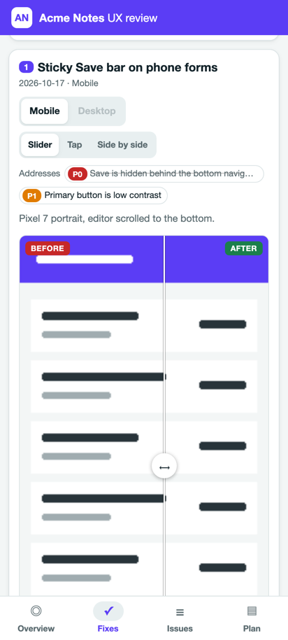
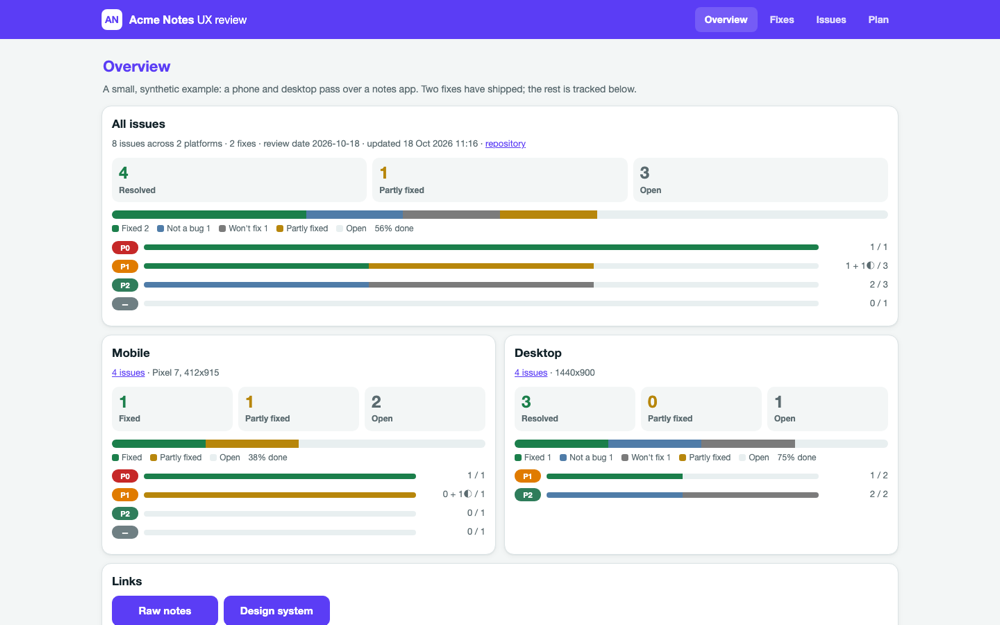

# review-kit

Track what a round of review and fixing changed: **issues found, fixes shipped with their evidence, and what is left**. Keep it all in one `review.json`, then publish it as a fast, offline, mobile-first static site.

There are four kinds of review:

- A **UI/UX review** records before/after screenshots.
- A **backend review** records code practice findings (security, correctness, errors, API design, architecture, tests), with tests and command output as evidence.
- An **ideas review** records research with cited sources, and ideas with their reasoning, evidence, alternatives and risks.
- A **design review** records 2-3 options for one decision, each built on its own git branch, scored against criteria agreed up front, with a recommendation, screenshots and the diff of each option.

Each kind has an agent playbook and optional [companion skills](#companion-skills). Together they make one flow: **ideas → design → adopt one option → UI/backend review of the result** (see [Ideas and designs](#ideas-and-designs)).

Agents using the skill **report first and fix only when told**. A review run records the problems and stops. Then you choose which issues to fix, for example "fix m-1 and m-3" or "do the P0s". Likewise, ideation never builds anything, design options live only on their own branches, and an option reaches your branch only when you say which one to adopt.

- **One data file.** `review.json` holds issues, fixes and the plan. It follows a versioned format with a [JSON Schema](schema/review.schema.json) ([format reference](docs/format.md)).
- **Zero dependencies.** It needs only Node.js 18+ (no runtime packages). The site is vanilla HTML, CSS and JS: no CDN, no build step, and it works from `file://`.
- **One site for every review.** With several reviews in the same repo, `review-kit build` (or `serve --watch`) publishes one site with a switch in the header (All, Ideas, Designs, UI/UX, Backend) and a combined overview.
- **Built for reviewing on a phone.** Bottom tabs, dark mode, a compare view (slider, tap to flip, or side by side), and a lightbox with pinch, wheel and double-tap zoom plus swipe. Issues can be filtered by platform, severity, status, area and text. Progress is broken down by severity and by platform.
- **Agent-friendly.** Fix agents write small hand-off JSON files. The orchestrator merges them with `review-kit apply-pending`. See [docs/workflow.md](docs/workflow.md). An agent skill drives the whole loop for any coding agent (see [Agent skill](#agent-skill) below).

<p> </p>

## Quick start

**1. Install once per machine.** This puts `review-kit` on your PATH, then `setup` links the agent skill into `~/.claude/skills/` if that folder exists:

```bash
npm i -g @horus52/review-kit && review-kit setup
```

Run the same line again to update; the skill is a symlink into the installed package, so it updates with it. Installing runs no scripts: the skill is only linked when you run `setup`. Options:

- `--with-companions` also links the bundled [companion skills](#companion-skills) into the skills folders.
- `--skills-dir DIR` links the skill into other agents' skills folders. Repeatable.
- `--no-skill` skips the skill.

For one-off use without installing, prefix any command with `npx`, for example `npx @horus52/review-kit build ui`.

**2. Attach it to a repo once per project:**

```bash
cd your-project
review-kit attach --name "Your App" --kind ui,backend      # or just --kind ui (the default); also ideas and design
```

This creates one review per kind, `.review/ui/` and `.review/backend/`. Each has a `review.json`, `screenshots/`, `pending/`, and a `.gitignore` for the built site; with both kinds, `.review/.gitignore` also ignores the combined site. UI reviews default to `--platforms mobile,desktop`. It also adds a short pointer to the repo's `AGENTS.md`, and to `CLAUDE.md` if there is one, so any coding agent in the repo knows to use the skill. Commit those files to share the setup with your team. Re-running `attach` is safe: it reuses the review and updates the pointer in place. `--no-agents-file` skips the pointer, and `--agents-file FILE` picks other files.

**3. Use it.** Ask your agent for a review ("run review-kit on the UI"). It reports the issues and waits. Then tell it which to fix, and it records each fix with its evidence. You can also drive it yourself:

```bash
review-kit add-issue ui --title "Save is hidden behind the bottom nav" --platform mobile --severity P0 --area Editor
review-kit add-fix ui --title "Sticky Save bar" --files src/Form.tsx \
  --pair mobile before.png after.png --resolves m-1
review-kit add-issue backend --title "No size limit on uploads" --severity P1 --area api --where "api/upload.py:40"
review-kit serve --watch                       # both reviews in one site (.review/site), previewed on localhost
review-kit serve ui --watch                    # or just one: builds .review/ui/site
```

The first argument is a path to a `review.json` or its folder, or a kind (`ui`, `backend`) meaning `.review/<kind>/`. With no argument, commands look for `review.json`, `.review/review.json`, `docs/review/review.json` and `review/review.json`, then for `.review/<kind>/review.json` (and `docs/review/<kind>/`). `build`, `serve` and `clean` act on all of them when there are several; commands that edit a review ask you to pick one. From a clone of this repository, run `npm install && npm run build`, then `node dist/cli.js <command>`.

## Commands

| Command | What it does |
| --- | --- |
| `attach [REPO]` | Sets a repo up in one step. For each `--kind` (`ui`, `backend`, `ideas`, `design`; default `ui`), it creates `.review/<kind>/` unless that review already exists; `--dir` changes the parent folder. It then adds or updates a review-kit pointer in `AGENTS.md`, plus `CLAUDE.md` if present. `--agents-file FILE` (repeatable) and `--no-agents-file` change which files get the pointer. |
| `init [DIR]` | Scaffolds `DIR/review.json`, `screenshots/`, `pending/` and a `.gitignore`. DIR defaults to `.review`. Options: `--kind ui\|backend\|ideas\|design` (sets the title and platform defaults), `--name`, `--title`, `--platforms a,b`, `--accent "#hex"`, `--ignore-screenshots`. |
| `validate [REVIEW]` | Checks the file against the schema and its cross-references: unknown platforms, severities, issue or fix ids, duplicate ids and missing images. |
| `build [REVIEW...] [--out DIR]` | Validates, copies the referenced images, and writes `index.html`, `app.css`, `app.js` and `data.js`. One review goes to `site/` next to its `review.json` by default. Several reviews (found with no argument, given one by one as in `build ui backend`, or as their parent folder as in `build .review`) build **one combined site** in their parent folder, `.review/site/`, with a switch between them; `build ui` still builds just that review. `--max-width N` downscales PNG/JPEG with `sips` or ImageMagick when available. Without them, images are copied unchanged. |
| `serve [REVIEW...\|SITE] [--port 8787] [--host 127.0.0.1] [--watch]` | Builds, then previews locally; with several reviews it serves the combined site. Bound to `127.0.0.1` (the default), it only answers requests addressed to `localhost`, `127.0.0.1` or `[::1]`, which blocks DNS-rebinding pages. Add `--host 0.0.0.0` to share on your network without a login. `--watch` rebuilds when any served `review.json` or its `screenshots/` change. |
| `add-issue` | Adds issues from flags (`--title --platform --severity --area --status --details --note --where --screenshot --top`) or from `--json`/`--file`, which take one object or a list. `--update` merges into an existing id. |
| `add-fix` | Adds a fix from flags (`--title --summary --files --pair PLATFORM BEFORE AFTER --resolves ids --partial ids --commit --link Label=URL`) or from `--json`/`--file`. The JSON can be a bare fix or a hand-off envelope. It assigns the next number and today's date. |
| `add-plan` | Adds a roadmap item: `--group --title --phase --status --effort --files --severity`. |
| `mark [REVIEW] STATUS ID...` | Sets the status of issues (`open partial fixed notabug wontfix`) or plan items (`todo doing partial done dropped`). `--note` adds a note and `--fix` links the item to a fix. |
| `apply-pending [REVIEW]` | Merges every `pending/*.json` in natural order and renames each one to `*.applied.json`. It stops at the first file that would not validate. |
| `clean [REVIEW...] [--orphans] [--dry-run]` | Removes the built `site/` (only a folder review-kit built), and the `pending/*.applied.json` files that have been merged. With several reviews it also removes the combined `.review/site/`. `--orphans` also deletes screenshots that `review.json` no longer references, keeping any that unmerged `pending/*.json` files use. `--keep-site` and `--keep-applied` skip a part, and `--dry-run` only lists what would go. |
| `companions [install\|update]` | Lists the companion skills for each kind and which copy will be used: an installed one if present, otherwise the bundled one. `install` links the bundled copies into `~/.claude/skills`, so the agent loads them as skills (`--skills-dir DIR` picks other folders). `update` is for maintainers and re-downloads the bundle from the pinned commits. `--kind` limits it to one kind, and `--path NAME` prints one skill's folder. |
| `shot` | Takes one Playwright screenshot for before/after evidence: `--url --out --viewport mobile\|tablet\|desktop\|WxH --full --dark --storage --steps --wait-for --wait --selector --quality`. See [Screenshots](#screenshots). |
| `setup` | Links the agent skill into `~/.claude/skills` (when `~/.claude` exists) or into each `--skills-dir DIR`. An existing copy that is not a link is moved to `~/.review-kit-backups/` first. `--with-companions` also links the companion skills; `--no-skill` skips the skill. |
| `home` | Prints the folder the kit is installed in, for the docs, the skill and the site template. |
| `summary [REVIEW]` | Prints a Markdown progress summary: totals, counts by severity and platform, latest fixes, and the most severe open issues; for ideas and designs, ideas by status, the top ideas, and each proposal with its options, recommendation and adoption. |
| `add-research` | Adds a research finding: `--title --summary --source "Label=URL"` (repeatable) `--quote --accessed --kind --confidence --tags`. `--update --id` merges. |
| `add-idea` | Adds an idea: `--title --problem --proposal --reasoning --evidence r-1,r-2 --alternatives --risks --pro --con --effort --impact --confidence --rank --tags`. `--update --id` merges. |
| `decide [REVIEW] IDEA STATUS` | Records the user's call on an idea (`proposed go maybe no done`) with `--note`. |
| `add-proposal` | Adds a design proposal: `--id --title --brief --idea --criterion "id=Label:weight"` (repeatable). |
| `option new [REVIEW] PROPOSAL OPTION` | Creates branch `design/<proposal>/<option>` from `--base` (default `HEAD`) and a worktree for it, by default outside the repo in `<repo>.designs/`. |
| `option record [REVIEW] PROPOSAL OPTION` | Records the option's write-up (`--summary --reasoning --pro --con --evidence`), scores (`--score crit=N[:note]`) and screenshots (`--shot PLATFORM PATH [CAPTION]`), and saves the branch's diff to `diffs/`. |
| `recommend [REVIEW] PROPOSAL OPTION` | Recommends an option, with `--reasoning`. |
| `adopt [REVIEW] PROPOSAL OPTION` | Squash-merges the option's branch into the current branch and commits (`--no-commit`, `--message`). Refuses with uncommitted changes outside the review folders. Never pushes. Agents run it only when you pick the option. |
| `discard [REVIEW] PROPOSAL` | Removes option branches and worktrees (`--option`, `--force`, `--dry-run`). The diffs and screenshots stay, so the site still shows every option. |

Image paths given on the command line or in hand-off files can be absolute. They are then copied into `screenshots/<fix-id>/` (or `screenshots/issues/`) and stored as relative paths.

## Example

[`examples/ideas-design/`](examples/ideas-design/) has an ideas review and a design review for a small task-list app deciding how to welcome new users: research with real sources, four ideas, and one proposal with three options, scores, a recommendation, diffs and screenshots. Build it with `review-kit build examples/ideas-design/.review`.

[`examples/basic-app/`](examples/basic-app/README.md) is a full walkthrough on a small task-list app. `run.sh` audits the app, applies three fixes with before/after screenshots (one of them through a hand-off file), triages what is left and builds the site. Its output is committed, so `review-kit serve examples/basic-app/review` shows the result straight away.

## Keeping the server running

`serve` is a normal foreground process. To keep it alive after the terminal or an agent's tool call ends, detach it:

```bash
nohup review-kit serve --port 8787 --watch > /tmp/review-kit.log 2>&1 &   # every review in .review/, one site
disown
```

You can also build once and serve `site/` with any static server, or open `site/index.html` directly.

## Ideas and designs

An **ideas review** answers "what should we build, and why". The agent frames the question, researches it (the codebase, the project's docs, standards and official docs, studies, comparable products), and records each finding with its sources, an accessed date, a short quote and a confidence. Then it records a few ideas, each with the problem, the proposal, the reasoning tied to specific findings, the alternatives it rejected (including doing nothing), risks, and effort, impact and confidence. It reports a ranked shortlist and stops; you mark each idea go, maybe or no.

A **design review** answers "which way should we build it". For a go idea, the agent agrees weighted criteria with you, then builds 2-3 genuinely different options, each on its own branch `design/<proposal>/<option>` in a worktree outside the repo, never on your branch. It takes the same screenshots or test runs for each option, scores every option on every criterion with a note, and recommends one, saying when another would be better. You pick; only then does it run `review-kit adopt`, which squash-merges that option into your branch. `review-kit discard` removes the other branches when you agree.

```bash
review-kit attach --kind ideas,design
review-kit add-research ideas --title "Users skip tutorials" --summary "..." --source "NN/g=https://www.nngroup.com/articles/mobile-app-onboarding/"
review-kit add-idea ideas --title "Teach in the empty list" --problem "..." --proposal "..." --reasoning "..." --evidence r-1
review-kit decide ideas i-1 go --note "worth trying"
review-kit add-proposal design --id first-run --title "First-run experience" --idea i-1 --brief "..." --criterion "clarity=Clarity:3"
review-kit option new design first-run empty-state --title "Teaching empty state"    # build and commit in the printed worktree
review-kit option record design first-run empty-state --score "clarity=4:..." --shot mobile shot.png
review-kit recommend design first-run empty-state --reasoning "..."
review-kit adopt design first-run empty-state                                       # only once you pick it
```

`validate` and `build` warn when the reasoning is thin: research without sources, ideas without reasoning, evidence, alternatives or risks, proposals without criteria or a recommendation, and unscored options. The site puts the reasoning first: an impact-vs-effort grid and status filters for ideas, every idea's evidence shown with its sources, and for each proposal a comparison matrix with weighted totals, the recommendation, the options side by side with the same screen, each option's diff, and copy buttons for `git switch` and `review-kit adopt`.

## One site for several reviews

When a repo has more than one review (for example `.review/ui/` and `.review/backend/`), `build` and `serve` with no argument publish them together in `.review/site/`:

- The header has a switch: **All** (an overview with each review's numbers side by side), then **Ideas**, **Designs**, **UI/UX** and **Backend**, in that order, for the reviews that exist. It is a row of links, so it works with the keyboard; on phones it gets its own full-width row with 44px targets.
- Each review keeps its own tabs (Overview, Fixes, Issues, Plan; Ideas, Research and Proposals when it has them), filters, accent colour and title. Switching review keeps the tab you are on.
- Links include the review: `#/backend/issues/issue-3` opens that issue in the backend review. Single-review sites keep their old links (`#/issues/issue-3`).
- `data.js` holds `window.REVIEWS = [{key, label, data}, ...]`, and each review's images and attachments are copied under `img/<key>/` and `files/<key>/`, so equal file names never collide.

The security model is the same as for one review: sanitised content, the Content Security Policy, a manifest of the files the server may send, and a builder that refuses unexpected files in the output folder.

## Privacy and publishing

Previews bind to localhost by default. To view one on a phone, explicitly share it with `review-kit serve --host 0.0.0.0`; anyone who can reach that port can read the review. Use hosting with authentication for private reviews.

Publish only the generated site folder. Everything in `data.js`, screenshots and linked attachments is public to anyone with access, including resolved issues and notes hidden by filters. Check screenshots for names and account details, and remove sensitive image metadata before adding them. Review files should contain public repository URLs rather than local checkout paths.

Build references must stay inside the review folder after resolving symlinks. Use `add-issue` or `add-fix` to explicitly import screenshots from elsewhere. Screenshots must be PNG, JPEG, GIF, WebP or AVIF; local attachments may also be PDF, text, Markdown, CSV, TSV, JSON, patch or diff files. Hidden files and common credential/session filenames are blocked. Review ordinary attachments for sensitive contents before adding them.

The builder refuses unexpected files and symlinks in an output directory, even with `--force`, so existing private files are left untouched. Choose a fresh `--out` directory when this happens. The preview server blocks hidden paths, external symlinks and directory listings; for generated sites it serves only files recorded in the build manifest. Rebuild older sites before serving them.

Both Markdown and HTML modes keep basic formatting and tables while stripping active tags, event handlers, styles and inline images. Add images through screenshot fields. Links allow HTTP, HTTPS, mailto and relative destinations; executable schemes and URLs containing credentials are blocked. Generated pages also restrict scripts and network connections with a Content Security Policy.

The repository and newly initialized reviews ignore common environment, private-key and browser-session files, including the `state.json` used below. Ignore rules do not remove previously committed secrets. Use a GitHub no-reply commit identity when you want to keep your email private.

## Screenshots

`review-kit shot` takes one Playwright screenshot. Playwright is not a dependency of review-kit: it is resolved from the project you run the command in, then from `PLAYWRIGHT_PATH`:

```bash
review-kit shot --url http://localhost:3000/settings \
  --out .review/ui/screenshots/fix-3/settings-before-mobile.png --viewport mobile [--full] [--dark] \
  [--storage state.json] [--steps steps.mjs] [--wait-for "main"] [--selector ".dialog"]
```

Take the **before** shot before you edit any code. Then take the **after** shot from the same URL, viewport and steps. [docs/workflow.md](docs/workflow.md) has more.

## Layout

```
src/                       TypeScript sources: cli, build, validate, markdown, images, edit, attach, companions, clean,
                           serve, summary, setup, shot (compiled to dist/ by `npm run build`; dist/cli.js is the command)
site/                      the site template (index.html, app.css, app.js)
schema/review.schema.json  the format (version 1)
docs/                      format reference, workflow and hand-off contract
skill/review-kit/          agent skill: SKILL.md, plus ui-review.md, backend-review.md, ideas-review.md and design-review.md playbooks
skill/companions/          bundled third-party skills (ui-ux-pro-max, wshobson/agents), each with LICENSE and SOURCE
examples/demo/             small synthetic review (committed, self-contained)
examples/basic-app/        a tiny real web app reviewed end to end by run.sh (committed output in review/)
examples/ideas-design/     an ideas review and a design review with three options (.review/ideas, .review/design)
test/                      node:test suites + Playwright smoke test
```

## Tests

```bash
npm test                                                               # build, then the unit tests (node:test)
PLAYWRIGHT_PATH=/path/to/node_modules/playwright node test/smoke.mjs   # browser smoke test: demo at 412x915, 1440x900, dark mode, combined sites, and ideas + design
```

## Agent skill

`skill/review-kit/SKILL.md` teaches a coding agent to use this kit in any repository. It isn't tied to one agent: it only assumes the agent can run shell commands and open image files. With it, an agent can set up `.review/`, capture before/after screenshots, record issues and fixes as it works (including parallel fix agents through `pending/`), build and serve the site, and summarise progress.

The file uses the `SKILL.md` format: a short YAML header (`name`, `description`) followed by Markdown instructions. There are three ways to give it to an agent:

- **Agents that load `SKILL.md` skills:** `review-kit setup` symlinks the skill folder into `~/.claude/skills/` (Claude Code) when it exists. For other agents, pass their skills folder: `review-kit setup --skills-dir <folder>`. Check the agent's docs for where user-level skills live. Because it is a symlink, updating the package updates the skill.
- **Agents that read a project instructions file such as `AGENTS.md`:** `review-kit attach` writes a pointer that tells the agent to read the skill (found with `review-kit home`) and how to install the kit if it's missing. Point `--agents-file` at a rules or custom-instructions file if your agent uses a different name.
- **Any other agent:** paste the body of `SKILL.md` into its prompt or task, or tell it to read `$(review-kit home)/skill/review-kit/SKILL.md` first.

The skill finds the kit through `review-kit` on PATH and `review-kit home`, so the kit can live anywhere.

## Companion skills

Each review kind has its own playbook next to `SKILL.md`. Each playbook leans on skills other people maintain. They are MIT licensed, and review-kit bundles them in [`skill/companions/`](skill/companions). Each folder keeps the upstream `LICENSE` and a `SOURCE` file with the exact commit it came from:

| Kind | Playbook | Companion skills | Source |
| --- | --- | --- | --- |
| `ui` | [ui-review.md](skill/review-kit/ui-review.md) | `ui-ux-pro-max`: searchable UX rules (accessibility, touch, layout, type, forms, navigation) to cite and rank findings | [nextlevelbuilder/ui-ux-pro-max-skill](https://github.com/nextlevelbuilder/ui-ux-pro-max-skill) (MIT) |
| `backend` | [backend-review.md](skill/review-kit/backend-review.md) | `api-design-principles`, `architecture-patterns`, `error-handling-patterns` | [wshobson/agents](https://github.com/wshobson/agents) (MIT) |
| `ideas` | [ideas-review.md](skill/review-kit/ideas-review.md) | none required | |
| `design` | [design-review.md](skill/review-kit/design-review.md) | `ui-ux-pro-max` for UI options; the three backend skills for API or architecture options | as above |

```bash
review-kit companions                      # which copy each review uses
review-kit companions install              # link the bundled copies into ~/.claude/skills (no download)
review-kit companions install --kind ui --skills-dir ~/.agents/skills
```

- Agents read the bundled copies through `review-kit companions` even when the skills aren't installed. `install` (or `review-kit setup --with-companions`) only makes them load as skills in their own right.
- An install never replaces a skill you already have; it only reports it. If you installed the same skill another way, for example as a Claude Code plugin, `review-kit companions` uses that copy.
- To move to newer upstream versions, bump the commit hashes in `src/companions.ts`, rebuild, run `review-kit companions update`, and review the diff.

## License

MIT, see [LICENSE](LICENSE).
